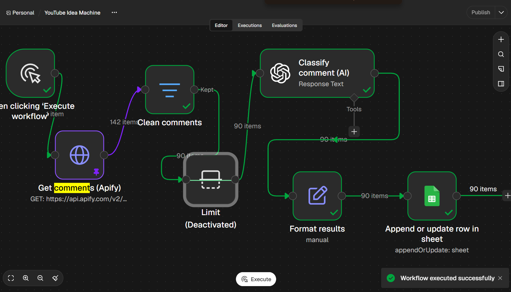

# YouTube Idea Machine

**Turning YouTube comments into video ideas with n8n + an LLM, and checking whether the AI actually got it right.**

Creators get hundreds of comments, but the useful ones (requests, questions, knowledge gaps) are buried under praise, opinions and spam. This project pulls the comments from one video, cleans them, has an LLM label each one, writes the results to Google Sheets, and then **evaluates the AI against my own hand labels**.

> Case study: *"How to Teach Yourself Business & Entrepreneurship"* by Analyzing Finance with Nick (176 comments incl. replies).

---

## Pipeline



| Step | Tool | Rows |
|---|---|---|
| 1. Pull comments | Apify (`streamers/youtube-comments-scraper`) via n8n HTTP Request | 142 |
| 2. Clean | n8n Filter (rules, no AI) | 90 |
| 3. Classify | OpenAI `gpt-4.1-mini-2025-04-14`, temperature 0, JSON output | 90 |
| 4. Reshape | n8n Edit Fields (re-attach `cid`, author, comment to the AI output) | 90 |
| 5. Store | Google Sheets, **Append or Update** matched on `cid` | 90 |

### Cleaning decisions (rule-based, before any AI)

| Removed | Count | Why |
|---|---|---|
| Creator's own comments and replies | 21 | Not audience signal (`authorIsChannelOwner = true`) |
| Replies from other users | 31 | Mostly reactions to other comments, no standalone context |
| **Kept: top-level audience comments** | **90** | |

I predicted 141 rows would survive the first filter and got 121, which is how I found out the scraper also returned reply threads. Predicting the output before running a step caught an issue a "success" message would have hidden.

### Design choices

- **Rules before AI.** Anything a simple condition can do (removing the creator, replies, empty text) is done with a filter: cheaper, faster and 100% accurate.
- **Idempotent writes.** *Append or Update* keyed on the comment ID means re-running the workflow updates rows instead of duplicating them.
- **Pinned test data.** During development the scraper output was pinned in n8n, so every test reused the same data at no extra scraping cost.
- **Pinned model version.** A dated model snapshot, not an alias, so results don't silently change.

---

## Labeling scheme

Each comment gets exactly one label:

| Label | Meaning |
|---|---|
| `request` | Asks for a video/topic, **or** states a knowledge gap the creator could cover |
| `question` | Asks something a video could answer, without asking for a video |
| `praise` | Thanks or support with no substantive content |
| `opinion` | Opinion, experience, advice or criticism (including hostile criticism) |
| `spam` | Promotion (often via a made-up story), service/collab offers, bot-like or unrelated |

For `request`, `question` and `opinion`, the model also returns a 2–5 word **topic**.

The 9 edge-case rules (e.g. *"praise + critique → opinion"*, *"collab offer → spam"*) came from comments **I** couldn't decide on while labeling by hand. Full list: [`rules.md`](rules.md). Those rules became the system prompt: [`prompt.md`](prompt.md).

---

## Evaluation

**Method:** I hand-labeled 30 randomly sampled comments (seed 42) **before** looking at any AI output, then compared them with the AI's labels by comment ID.

| | Agreement | 95% interval (Wilson) |
|---|---|---|
| Raw | **27 / 30 (90%)** | ~74% – 97% |
| After aligning 2 of my labels with my own pre-written rules | **29 / 30 (96.7%)** | ~83% – 99% |

With n = 30, one comment moves the score by 3.3 points, so treat these as a case study, not a benchmark.

### Not every disagreement is an AI error

| Comment | Me | AI | Type of disagreement |
|---|---|---|---|
| Offers to collaborate with the creator | request | spam | **My inconsistency**: my own Rule 3 says spam |
| "Thanks Nick. Commenting for the algorithm." | spam | praise | **My inconsistency**: my own Rule 5 says praise |
| Made-up travel story recommending a book | spam | opinion | **AI error** |

Splitting disagreements into *AI error / gap in the categories / inconsistency in the gold labels* showed that the gold labels, not the model, caused 2 of the 3 misses.

---

## Findings

### 1. The AI can't see coordinated spam
Two unrelated accounts posted personal-sounding stories that both promote the same obscure book. **The AI labeled both as `opinion`**, even though the prompt has an explicit rule for this. It caught all 3 obvious service offers (thumbnail designer, video editor, collab request).

**Why:** the model sees one comment at a time, and in isolation each story looks genuine. The pattern only shows up **across comments**. Catching coordinated campaigns needs a dataset-level check (e.g. the same product named by several accounts), not better per-comment prompting.

### 2. Rhetorical questions get labeled as questions
2 of the 17 `request`/`question` labels were sarcasm or insinuation phrased as a question. The question mark wins.

### 3. Only ~1 in 5 comments is a direct signal

| Label | Count (of 90) |
|---|---|
| opinion | 36 |
| praise | 33 |
| request | 9 |
| question | 8 |
| spam | 4 |

### 4. What this audience is asking for

| Theme | Comments | Idea |
|---|---|---|
| How to start from zero / turn theory into action | 5 | "How I'd learn business from zero: a 12-month plan" |
| Book list and resources | 3 | Quick win: pin the book list (no video needed) |
| Raising capital, M&A | 2 | "How small businesses raise capital" |
| Solo-founder operations (legal, tax, hiring, networking) | 2 | "Legal, taxes, first hire: basics for solo founders" |
| Live events (Austin, Nashville) | 2 | Demand signal for meetup cities |

One viewer asked *where* the creator's networking video was. It already exists, so that's a discoverability fix (link it in the description), not a content gap.

---

## Cost

| Item | Cost |
|---|---|
| Apify scrape (142 comments) | $0.28 |
| OpenAI classification (90 comments, mini model) | a few cents |
| Google Sheets API | free |
| n8n hosting (Railway) | free trial |

---

## Limitations

- One video, one channel; 30 hand-labeled comments.
- Replies excluded, although some contain real questions (e.g. *"Any tips on how to learn marketing?"*).
- `publishedTimeText` is relative text ("3 months ago"), not a date.
- 1 of the scraper's 35 requests failed, so a few comments may be missing.
- Labels are one person's judgment; no second annotator.

## Future improvements

1. Dataset-level spam check (same product/book named by multiple accounts)
2. Rule for rhetorical questions and timestamp-only comments
3. JSON Schema output so the model can't invent a label
4. Use the creator's own replies as a signal (e.g. *"I'm not qualified to make that video"*)
5. Replace Apify with the official YouTube Data API (free daily quota)
6. Scheduled runs across several videos/channels to compare themes

---

## Repo contents

```
├── README.md
├── workflow.json      # n8n workflow export (credentials, pinned data and IDs removed)
├── prompt.md          # system prompt used for classification
├── rules.md           # labeling rules
├── data/
│   ├── raw_comments.csv   # 142 rows as scraped (before cleaning)
│   ├── ai_results.csv     # 90 AI-labeled comments
│   └── my_labels.csv      # 30 hand labels + notes
└── docs/
    └── pipeline.png   # n8n canvas screenshot
```

## Run it yourself

1. Import `workflow.json` into n8n.
2. Add your own credentials: Apify API token (Bearer), OpenAI API key, Google service account with the target sheet shared to it.
3. Replace `YOUR_APIFY_DATASET_ID` in the Apify node and `YOUR_GOOGLE_SHEET_ID` in the Sheets node.
4. Test with the Limit node at 5, then deactivate it and run the full set.
